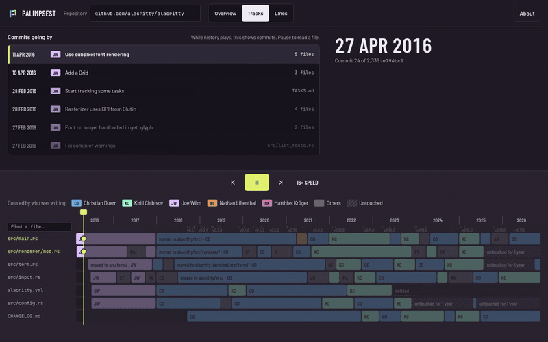

# Palimpsest


In the Middle Ages, parchment was too precious to throw away, so scribes **scraped old writing off and wrote over it**. The Greek παλίμψηστος (*palímpsēstos*) literally means **"scraped again"**. But the old text never fully disappears: it lingers faintly under the new one, and scholars still bring it back to light, like the lost works of Archimedes recovered from under a medieval prayer book. That is exactly what this app is, **Palimpsest**: every repository is written over thousands of times, and it lets you *see every layer underneath*.

---

**Palimpsest** is a git time machine for the web: open a public repository, then scrub through its history like a video. Every file is a track, colored by who was writing it, so you can watch code be born, change hands, move and disappear, then zoom in on any single line to see who wrote it, when, and why.

**Try it: [palimpsest.nayed-saidali.workers.dev](https://palimpsest.nayed-saidali.workers.dev)**



Tools like [Gource](https://gource.io) animate a repository as a tree of files. Palimpsest shows it as tracks you can scrub, and goes down to the single line.

## Three views of one moment

- **Overview**: one track per folder, taller for bigger folders, with who wrote the code that exists on the day you are looking at.
- **Tracks**: one track per file, and the selected file exactly as it was at the playhead.
- **Lines**: one track per line of a file, changing color where someone rewrote it, with each line's story: who touched it, when, and the reason they gave.

The playhead is shared: the date stays the same as you move between views. Every moment has its own address, so any point in any repository is a link you can share.

## In plain words

- **Everything runs in your browser.** There is no account and no server that stores anything. The only outside request for a pasted repository goes through a small proxy to GitHub, because GitHub does not let a browser fetch a repository directly. Downloaded repositories are kept in your browser's storage so they open quickly next time.
- **It works with public GitHub repositories.** Repositories with more than 50,000 commits are refused, so the browser tab stays responsive.
- **History follows the default branch's first-parent line**, so side branches merged in appear as their merge commits, credited to whoever wrote the branch.
- **The three demo repositories are precomputed**: [alacritty](https://github.com/alacritty/alacritty), [ripgrep](https://github.com/BurntSushi/ripgrep) and [docker/compose](https://github.com/docker/compose). Their history is shown with thanks to their authors.

## How it is built

React and TypeScript for the interface, a canvas for the timeline, and one Rust core that builds the demo data natively and reads pasted repositories as WebAssembly, in a Web Worker.

| Folder | What it is |
| --- | --- |
| `core/` | The history logic: walking the first-parent history, renames, who was writing when, line history. |
| `cli/` | `palimpsest build-data <clone> -o <file>`, which builds the demo data. |
| `wasm/` | The core for the browser: reads a downloaded pack file, newest commits first. |
| `proxy/` | A Cloudflare Worker that forwards git's read-only requests to GitHub, and nothing else. |
| `web/` | The app. |
| `docs/` | The project brief and the designs. |

### Running it

You need Rust with the `wasm32-unknown-unknown` target, `wasm-bindgen-cli` 0.2.130, Node and pnpm.

```sh
rustup target add wasm32-unknown-unknown
cargo install wasm-bindgen-cli --version 0.2.130 --locked
cd web && pnpm install
pnpm wasm        # build the core for the browser
pnpm dev         # http://localhost:5173, with the git proxy at /git-proxy
```

Other commands:

```sh
cargo test --workspace            # the core, against fixture repositories
pnpm test                         # unit tests (in web/)
pnpm test:e2e                     # browser tests, in the installed Google Chrome
pnpm build                        # production build in web/dist
./scripts/build-demo-data.sh      # rebuild web/public/data from pinned commits
```

### Deploying

Both parts run on Cloudflare: the site as static files (Workers static assets, which Cloudflare Pages is now part of, configured in `web/wrangler.jsonc`) and the proxy as a Worker (`proxy/wrangler.toml`, which lists the origins allowed to use it). After `wrangler login`:

```sh
cd proxy && ../web/node_modules/.bin/wrangler deploy   # the git proxy
cd web && pnpm ship                                    # build with the proxy's address, then deploy
```

## Credits

- The demo data is derived from the history of [alacritty](https://github.com/alacritty/alacritty) (Apache-2.0 or MIT), [ripgrep](https://github.com/BurntSushi/ripgrep) (MIT or Unlicense) and [docker/compose](https://github.com/docker/compose) (Apache-2.0). The browser tests replay recorded answers for [walkdir](https://github.com/BurntSushi/walkdir) (MIT or Unlicense).
- Fonts: [Barlow](https://github.com/jpt/barlow) and [JetBrains Mono](https://github.com/JetBrains/JetBrainsMono), under the SIL Open Font License.

## License

[MIT](LICENSE)
