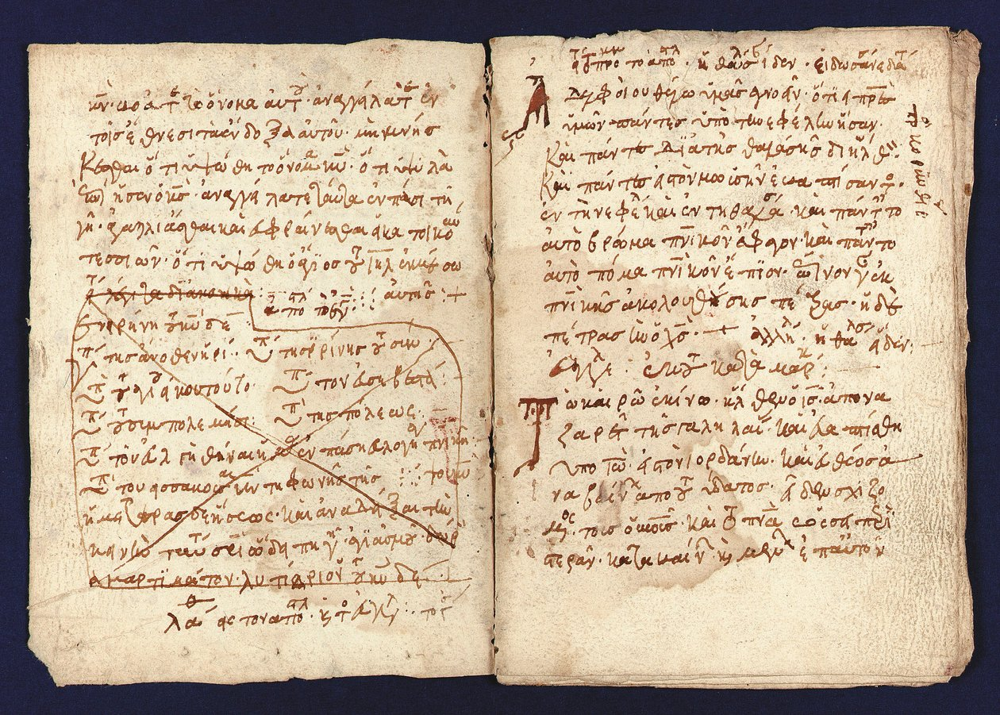

# Palimpsest

In the Middle Ages, parchment was too precious to throw away, so scribes **scraped old writing off and wrote over it**. The Greek παλίμψηστος (*palímpsēstos*) literally means **"scraped again"**. But the old text never fully disappears: it lingers faintly under the new one, and scholars still bring it back to light, like the lost works of Archimedes recovered from under a medieval prayer book. That is exactly what this app is, **Palimpsest**: every repository is written over thousands of times, and it lets you *see every layer underneath*.

---

**Palimpsest** is a git time machine for the web: open a public repository, then scrub through its history like a video. Every file is a track, colored by who was writing it, so you can watch code be born, change hands, move and disappear, then zoom in on any single line to see who wrote it, when, and why.

<!-- Notes for whoever finishes this README. Delete this block before publishing.

- The image above does not exist yet. Add the illustration at docs/images/Palimpsest.png, or remove the line. It is meant to match the Baroque-painting style of the author's other project READMEs. The prompt drafted for it:

  A Baroque oil painting of a scholar in a candlelit stone library, holding a sheet of old parchment up to a shaft of golden light. Through the parchment, faint lines of older, erased handwriting glow beneath the newer text, like a ghost of the page. Around the scholar lie open manuscripts, a quill, an hourglass and an armillary sphere. Warm gold and deep brown tones with a sky-blue window, in the painterly style of a 17th-century Italian master.

- The etymology (palímpsēstos, "scraped again") and the Archimedes example (works of Archimedes recovered from under a later prayer book) were written from general knowledge and not checked against a source. Verify them before publishing.
- The name is easy to misspell ("palimpset", "palimsest"). Nobody has checked whether the GitHub name, the crate names or a domain are free. Consider registering the common misspellings, or using a short domain with the full name on the page.
- The README should also say, in plain words:
  - Everything runs in your browser. There is no account and no server that stores anything. The only outside request for a pasted repository goes through a small proxy to GitHub, because GitHub does not let a browser fetch a repository directly.
  - It works with public GitHub repositories. Very large ones are refused, with the commit limit stated.
  - History follows the default branch's first-parent line, so side branches merged in appear as their merge commits.
  - The three demo repositories (alacritty, ripgrep, docker/compose) are precomputed. Credit the projects and link to them.
  - The theme is chosen with the sun and moon in the header and does not follow the system setting.
- A short screen recording of the app playing belongs right under the pitch. Moving history is the whole point, and a still image undersells it.
- Positioning, in one line: tools like Gource animate a repository as a tree of files; Palimpsest shows it as tracks you can scrub, and goes down to the single line. (Check the comparison is fair before publishing.)
- Stack line for the README: React and TypeScript for the interface, a canvas for the timeline, and one Rust core that builds the demo data natively and reads pasted repositories as WebAssembly.
-->
